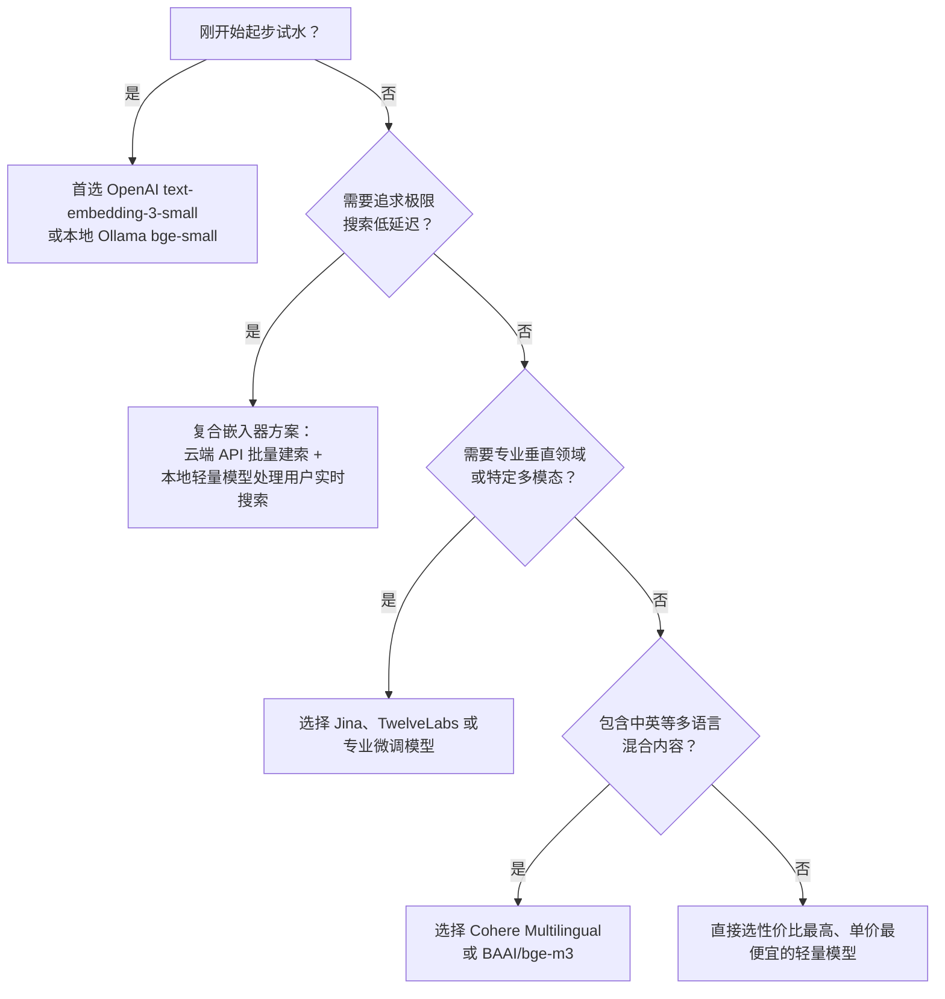

挑选向量模型绝不仅仅看准确率天花板。调用成本、批量建索速度、单次搜索网络延迟、向量维度大小以及特定垂直领域的适配度同样关键。在绝大多数实际业务中，**一个更小、更快的模型往往比参数量庞大的昂贵模型更实用**。

## 主流服务商及优势一览

| 提供商 | 代表模型 | 核心优势 | 配置指南 |
| :--- | :--- | :--- | :--- |
| **OpenAI** | text-embedding-3-small, text-embedding-3-large | 生态最成熟，开箱即用，综合质量极高 | [配置 OpenAI](/capabilities/hybrid_search/how_to/configure_openai_embedder) |
| **Cohere** | embed-v4.0, embed-multilingual-v3.0 | 业界顶级多语言理解能力，支持图文跨模态 | [配置 Cohere](/capabilities/hybrid_search/how_to/configure_cohere_embedder) |
| **Voyage AI** | voyage-4, voyage-4-lite, voyage-4-large | 前 SOTA 级别，灵活自选维度，具备垂直领域微调 | [配置 Voyage](/capabilities/hybrid_search/providers/voyage) |
| **Jina** | jina-embeddings-v4, v5-text-small/nano | 超长 32K 上下文，支持 PDF 与图文混合，轻量极快 | [配置 Jina](/capabilities/hybrid_search/providers/jina) |
| **TwelveLabs** | marengo3.5, marengo3.0 | 视频/音视频跨模态全能向量搜索 | [配置 TwelveLabs](/capabilities/hybrid_search/providers/twelvelabs) |
| **Google Gemini** | gemini-embedding-001 | 3072 高维，深度集成谷歌生态 | [配置 Gemini](/capabilities/hybrid_search/providers/gemini) |
| **Cloudflare** | bge-small/base/large, qwen3 | 边缘网络超低延迟，提供慷慨的免费额度 | [配置 Cloudflare](/capabilities/hybrid_search/providers/cloudflare) |
| **AWS Bedrock** | Titan v2, Nova, Cohere on Bedrock | 适合已有 AWS 企业架构及合规要求 | [配置 Bedrock](/capabilities/hybrid_search/providers/bedrock) |
| **HuggingFace (本地)**| 任意兼容模型（如 BAAI/bge） | 零 API 费用，无网络外发，数据不出本地服务器 | [配置 HuggingFace](/capabilities/hybrid_search/how_to/configure_huggingface_embedder) |

## 为什么“小模型”通常反而是更优解？

大模型并不总意味着更好的搜索体验。在混合搜索架构中，Meilisearch 会用[智能自适应打分](/capabilities/hybrid_search/overview#smart-result-ranking)将关键词与语义两路融合。**全文检索已经把字面精准匹配做到了极致，向量语义端只需要负责捕捉核心意图和语境，而不需要纠结微小的字面细节。**

这意味着一个小而快的高性价比模型（例如 384 维度的轻量模型）完全足够。384 维与 3072 维在混合搜索下的体验差距微乎其微，但前者节约了数倍的内存开销、建索成本和网络延迟。

除非你有明确的超高精度要求，否则**强烈建议优先选择轻量、便宜且低延迟的模型**。例如 `text-embedding-3-small`、`voyage-4-lite`、`jina-embeddings-v5-text-nano` 或国内的 `bge-small-zh`。

## 关键技术选型指标

### 1. 成本与速率限制 (Cost & Rate limits)
- **免费/本地方案**：本地部署的 HuggingFace / Ollama 模型完全没有 API 调用计费。
- **并发限速**：使用第三方商业 API 时，过低的并发 QPS 可能会导致大规模批量建索变得漫长。Meilisearch 会自动处理 429 报错重试，但在生产环境建议申请更高档位的调用配额。

### 2. 向量维度大小 (Dimensions)
- **384 维**：建索极快，占用内存极小，适合绝大多数常规场景。
- **768 ~ 1024 维**：质量与性能的经典平衡点（如 BERT/BGE 常用规格）。
- **1536 ~ 3072 维**：超高语义颗粒度，但内存消耗与索引体积较大，边际效益递减。

### 3. 多语言与垂直领域特征
如果你的业务以中文为主或包含多语种混杂，请务必选择对中文或多语言有官方评测背书的模型（如 Cohere Multilingual、BAAI/bge-m3、Jina 等），避免使用仅对英文优化的单一模型。

## 极限性能利器：复合嵌入器 (Composite Embedders)

如果你既想要云端强大的批量建索吞吐，又想要单次用户搜索时绝对零网络延迟的极致响应，可以利用[复合嵌入器机制](/capabilities/hybrid_search/advanced/composite_embedders)：
- **建索时**：使用云端 API（如 Cloudflare 或远程 GPU 推理端）高并发吞吐计算；
- **用户检索时**：使用跑在 Meilisearch 本地容器内的 HuggingFace 轻量模型，直接在进程内存中秒级将用户输入转化为向量，省去外网 HTTP 往返耗时。

## 选型决策流程图

